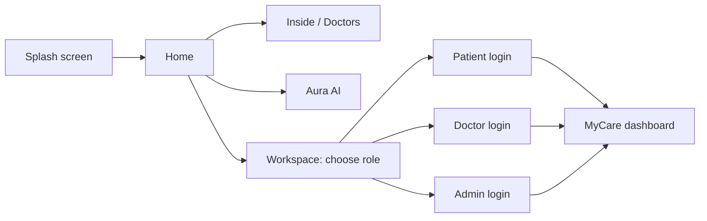
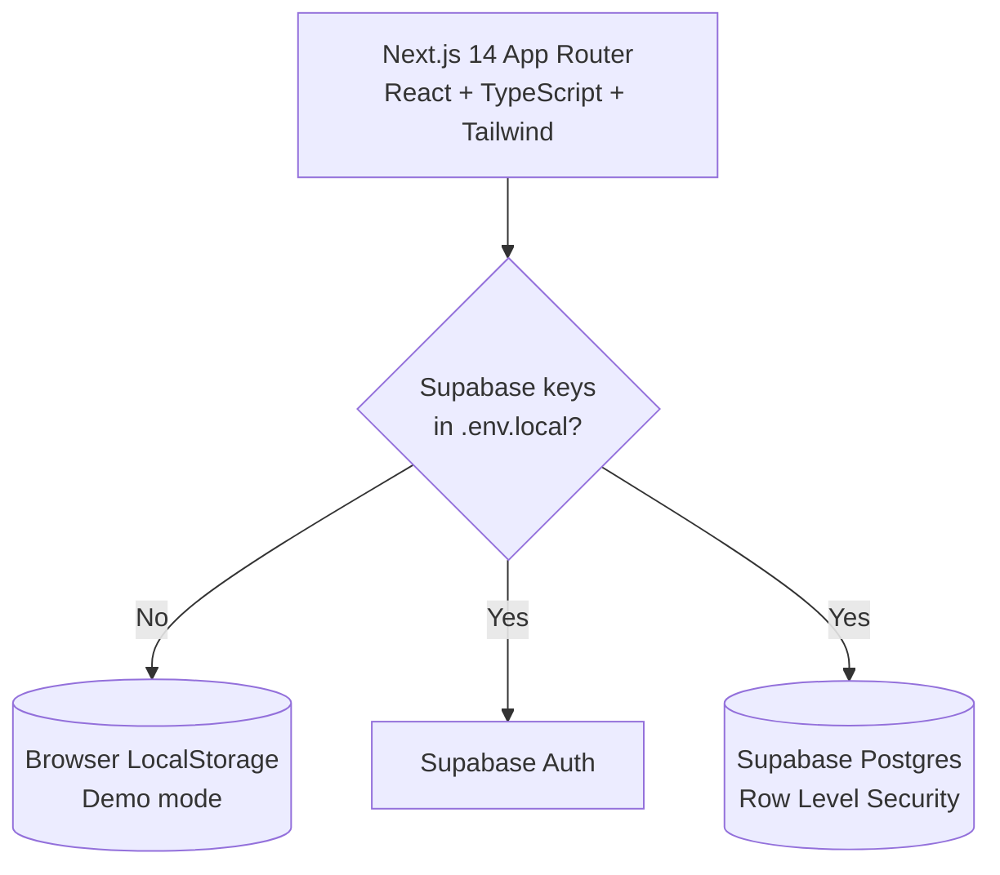

<div align="center">

# MEDIVANCE

### AI-Powered Doctor Appointment System

*A healthcare appointment platform for patients, doctors and administrators, built with Next.js and Supabase.*


%20%7C%20Supabase-0f766e?style=flat-square)


[Overview](#overview) · [Features](#features) · [Setup](#installation) · [Supabase](#supabase) · [Deploy](#deployment) · [Limitations](#limitations)

</div>

---

## 📑 Table of Contents

| # | Section | # | Section |
|---|---|---|---|
| 1 | [Project Overview](#overview) | 12 | [Installation and Local Setup](#installation) |
| 2 | [Vision and Objectives](#vision) | 13 | [Environment Variables](#env) |
| 3 | [Key Features](#features) | 14 | [Demo Login Credentials](#demo) |
| 4 | [Modules and Pages](#modules) | 15 | [Supabase Integration](#supabase) |
| 5 | [Technology Stack](#stack) | 16 | [Security and Role-Based Access](#security) |
| 6 | [User Roles and Access](#roles) | 17 | [Running and Building](#running) |
| 7 | [Screens and User Journey](#journey) | 18 | [Deployment (Vercel)](#deployment) |
| 8 | [Theme and UI Design](#theme) | 19 | [Limitations and Simulated Features](#limitations) |
| 9 | [Splash Screen](#splash) | 20 | [Future Enhancements](#future) |
| 10 | [Architecture](#architecture) | 21 | [Troubleshooting](#troubleshooting) |
| 11 | [Folder Structure](#structure) | 22 | [Project Status and Credits](#status) |

---

<a id="overview"></a>
## 1. 🏥 Project Overview

**MEDIVANCE** is a doctor appointment system with a hospital-style website, role-based portals for **patients, doctors and administrators**, and a simulated AI assistant called **Aura AI**.

The application runs in two operating modes, selected automatically by environment variables:

| Mode | Data storage | Login | When it is used |
|---|---|---|---|
| **Demo mode** | Browser LocalStorage | Simulated | No Supabase keys in `.env.local` |
| **Supabase mode** | Supabase Postgres | Supabase Auth with Row Level Security | Both `NEXT_PUBLIC_SUPABASE_*` variables are set |

> [!NOTE]
> Demo mode is a frontend simulation. It needs no backend and no API keys, which makes it safe to run and present anywhere.

---

<a id="vision"></a>
## 2. 🎯 Project Vision and Objectives

- Show a realistic end-to-end appointment workflow: browse doctors, book, manage and review.
- Provide separate, role-appropriate workspaces for patients, doctors and administrators.
- Build the frontend first, with data access structured so that Supabase can replace LocalStorage.
- Enforce data access rules at the database level (Row Level Security), not only in the interface.
- Present a modern, consistent healthcare brand across light and dark themes.

---

<a id="features"></a>
## 3. ✨ Key Features and Functionalities

| Area | Feature | Status |
|---|---|---|
| Website | Hospital hero, ambiance gallery, departments, facilities, patient journey, stats, doctors, FAQ, contact | ✅ Implemented |
| Facilities | 15 facility panels with descriptions and click-to-enlarge view | ✅ Implemented |
| Appointments | Booking and management per role | ✅ Implemented |
| Double-booking | Prevented by a database unique index on doctor + date + time for active appointments | ✅ Implemented (Supabase mode) |
| Authentication | Supabase Auth with hashed passwords | ✅ Implemented (Supabase mode) |
| Access control | Row Level Security for patient, doctor and admin data | ✅ Implemented (Supabase mode) |
| Data seeding | 12 doctors, 10 patients, appointments, reviews and demo logins | ✅ Implemented (`npm run seed:supabase`) |
| Theming | Dark and light themes with animated toggle | ✅ Implemented |
| Splash | Full-screen animated splash with Skip button | ✅ Implemented |
| Aura AI | Assistant chat experience | 🧪 Simulated |
| Video consultation | Video call experience | 🧪 Simulated |
| Payments | Pay Now flow | 🧪 Simulated, no payment gateway |
| Upgrade features | Payments, doctor approval, rescheduling, account recovery | 📄 See [`UPGRADE_GUIDE.md`](UPGRADE_GUIDE.md) and [`TESTING_STATUS.md`](TESTING_STATUS.md) |
| Real AI provider, video provider, payment gateway, medical-record tables | Not included | 🔮 Planned |

**Legend:** ✅ implemented · 🧪 simulated, no real service behind it · 📄 documented separately · 🔮 not yet built

---

<a id="modules"></a>
## 4. 🧩 Application Modules and Pages

**Navbar:** Home · Inside · Doctors · Appointments · Aura AI · MyCare · Workspace, plus **Login** and **Book now**.

| Page | Route | Purpose |
|---|---|---|
| **Home** | `/` | Hospital hero, ambiance gallery, departments, facilities, patient journey, then stats, doctors, FAQ and contact |
| **Inside** | | The 15 facility panels with descriptions and a click-to-enlarge view |
| **Doctors** | | Doctor listing |
| **Appointments** | | Appointment booking and listing |
| **Aura AI** | `/aura-ai` | Simulated AI assistant |
| **Workspace** | `/login` | Role selection entry point to the three portals |
| **MyCare** | | Your personal dashboard (patient, doctor or admin) |

> Routes are listed only where they are confirmed. Add the remaining paths from your `app/` folder if you want a complete route table.

---

<a id="stack"></a>
## 5. 🛠️ Technology Stack

| Layer | Technology |
|---|---|
| Framework | Next.js 14 (App Router) |
| UI library | React |
| Language | TypeScript |
| Styling | Tailwind CSS, with theme colours as CSS variables in `app/globals.css` |
| Charts | Recharts |
| Notifications and dialogs | SweetAlert2 |
| Icons | Lucide |
| Demo data | Browser LocalStorage |
| Backend (optional) | Supabase: Auth, Postgres, Row Level Security |
| Hosting | Vercel |

---

<a id="roles"></a>
## 6. 👥 User Roles and Access

| Role | What they can access |
|---|---|
| **Patient** | Their own profile and their own appointments |
| **Doctor** | Their own appointments and the patients booked with them |
| **Admin** | All data, including doctor records |

**Role assignment (Supabase mode):**
- Public sign-up can only create a **patient**.
- **Doctor** and **admin** roles can only be assigned with the service-role key (seed script or Supabase Dashboard).

---

<a id="journey"></a>
## 7. 🧭 Application Screens and User Journey



1. **Splash** plays, then lands on **Home**.
2. The visitor explores facilities, doctors and Aura AI.
3. **Workspace** (`/login`) lets them pick a role and sign in. Each login page has a **Use demo account** helper.
4. **MyCare** shows the dashboard for the signed-in role.

---

<a id="theme"></a>
## 8. 🎨 Theme and UI Design

| Theme | Look |
|---|---|
| **Dark** | Aura AI look: deep blue glass, with intentionally subtle glow |
| **Light** | Hospital look: white and teal, serif headings |

- The toggle cross-fades the whole site using the View Transitions API, with a fallback for browsers that lack it.
- All colours are CSS variables in `app/globals.css`.

---

<a id="splash"></a>
## 9. 🎬 Splash Screen Experience

- File: `public/splash/aura-splash.gif`
- Plays **full screen on every refresh** for about **5.6 seconds**.
- A **Skip** button is available.
- Afterwards the app lands on the home page.

---

<a id="architecture"></a>
## 10. 🏗️ Project Architecture



- The frontend is a single Next.js application.
- Data access is written so that Supabase can replace LocalStorage.
- In Supabase mode, security rules live in the database, so editing the frontend cannot bypass them.

---

<a id="structure"></a>
## 11. 📁 Folder Structure

Only paths confirmed in the project documentation are shown. `…` marks content not listed here.

```text
medivance/
├── app/
│   ├── globals.css            # theme colours as CSS variables
│   ├── aura-ai/               # simulated AI assistant page
│   ├── login/                 # Workspace role-select page
│   └── …                      # other routes
├── public/
│   ├── splash/
│   │   └── aura-splash.gif    # full-screen splash
│   ├── facilities/
│   │   └── 01.jpg … 15.jpg    # facility images
│   └── images/
│       ├── hero-night.jpg     # home hero
│       └── aura-doctor.jpg    # Aura AI visual
├── supabase/
│   ├── schema.sql             # base tables, no-double-booking rule, security policies
│   └── …                      # migrations 001-005, Edge Function (see UPGRADE_GUIDE.md)
├── UPGRADE_GUIDE.md           # migrations 001-005, Edge Function, e-mail settings
├── TESTING_STATUS.md          # what is and is not tested
├── package.json
└── README.md
```

**Replacing assets:** swap the files above, keeping the same names. The facility images are small concept images, so use larger originals if you have them.

---

<a id="installation"></a>
## 12. ⚙️ Installation and Local Setup

```bash
npm install
npm run dev        # http://localhost:3000
```

With no `.env.local`, the app starts in **Demo mode** and works immediately.

---

<a id="env"></a>
## 13. 🔐 Environment Variables

Create `.env.local` in the project root. Use your own values in place of the placeholders.

```env
NEXT_PUBLIC_SUPABASE_URL=https://YOUR-PROJECT-REF.supabase.co
NEXT_PUBLIC_SUPABASE_ANON_KEY=YOUR_ANON_KEY
SUPABASE_SERVICE_ROLE_KEY=YOUR_SERVICE_ROLE_KEY   # local seed script only
```

| Variable | Required | Purpose |
|---|---|---|
| `NEXT_PUBLIC_SUPABASE_URL` | For Supabase mode | Supabase project URL |
| `NEXT_PUBLIC_SUPABASE_ANON_KEY` | For Supabase mode | Public anon key used by the browser |
| `SUPABASE_SERVICE_ROLE_KEY` | Seeding only | Used by `npm run seed:supabase` on your computer |

> [!CAUTION]
> Never prefix the service-role key with `NEXT_PUBLIC`, never commit `.env.local`, and never add the service-role key to Vercel.

---

<a id="demo"></a>
## 14. 🔑 Demo Login Credentials

| Role | Email | Password |
|---|---|---|
| Patient | `patient@medivance.com` | `Patient@123` |
| Doctor | `doctor@medivance.com` | `Doctor@123` |
| Admin | `admin@medivance.com` | `Admin@123` |

Each login page has a **Use demo account** button.

> [!WARNING]
> These are demo accounts only. In Demo mode, passwords are stored in plain text in LocalStorage. This is a frontend simulation and **not** secure authentication. Do not reuse these passwords anywhere.

---

<a id="supabase"></a>
## 15. 🗄️ Supabase Integration and Database Setup

One-time setup, about 10 minutes.

| Step | Action |
|---|---|
| 1 | Run `npm install`. |
| 2 | In Supabase, open **SQL Editor → New query**, paste all of `supabase/schema.sql` and click **Run**. If it warns about destructive operations, click "Run query": it only recreates the MEDIVANCE tables. This creates the tables, the no-double-booking rule and the security policies. |
| 3 | Go to **Authentication → Sign In / Providers → Email** and turn **"Confirm email" OFF**. Otherwise new patients must click an email link before they can sign in. |
| 4 | Go to **Project Settings → API**, copy the **service_role** key and add it to `.env.local` as `SUPABASE_SERVICE_ROLE_KEY`. |
| 5 | Run `npm run seed:supabase` to load 12 doctors, 10 patients, appointments and reviews, and to create the demo logins. |
| 6 | Run `npm run dev`, or `npm run build` then `npm start`, and sign in with the [demo accounts](#demo). |

### Adding a doctor from the Admin portal

Saving a doctor creates the **doctor record**. To let that doctor sign in, create a login in **Dashboard → Authentication → Add user** with the **same email**, and set app metadata `{"role":"doctor"}` (or follow the seed script pattern). The login links to the doctor record automatically.

### Final upgrade (payments, doctor approval, rescheduling, recovery)

See [`UPGRADE_GUIDE.md`](UPGRADE_GUIDE.md) for migrations 001-005, the Edge Function and e-mail settings, and [`TESTING_STATUS.md`](TESTING_STATUS.md) for what is and is not tested.

---

<a id="security"></a>
## 16. 🛡️ Security and Role-Based Access

**Supabase mode**

| Control | How it works |
|---|---|
| Password handling | Handled only by Supabase Auth (hashed). The browser never sees other people's passwords. |
| Sign-up | Public sign-up can only create a patient. |
| Privileged roles | Doctor and admin roles require the service-role key (seed script or Dashboard). |
| Row Level Security | Patients see only their own appointments and profile. Doctors see their own appointments and their booked patients. Admin sees everything. Direct edits to the frontend cannot override this. |
| No double-booking | Enforced by a unique index on doctor + date + time for active appointments. |
| Secret handling | The service-role key stays on your computer and is not deployed. |

**Demo mode**

Demo mode provides **no real security**. Credentials and data live in the browser's LocalStorage.

> [!IMPORTANT]
> This project has not been independently security-audited. Treat it as an academic project, and review it before using it with real patient data.

---

<a id="running"></a>
## 17. ▶️ Running and Building the Application

| Command | Purpose |
|---|---|
| `npm install` | Install dependencies |
| `npm run dev` | Start the development server at `http://localhost:3000` |
| `npm run build` | Create a production build |
| `npm start` | Serve the production build |
| `npm run seed:supabase` | Seed Supabase with demo data and logins (needs the service-role key locally) |

---

<a id="deployment"></a>
## 18. 🚀 Deployment Guide (Vercel)

1. Push the repository to GitHub.
2. Import the repository in Vercel.
3. In **Project Settings → Environment Variables**, add:
   - `NEXT_PUBLIC_SUPABASE_URL`
   - `NEXT_PUBLIC_SUPABASE_ANON_KEY`
4. Deploy.

> [!CAUTION]
> Do **not** add `SUPABASE_SERVICE_ROLE_KEY` to Vercel.

Without the two Supabase variables, the deployed site runs in Demo mode.

---

<a id="limitations"></a>
## 19. ⚠️ Project Limitations and Simulated Features

| Item | Reality |
|---|---|
| **Aura AI** | Simulated assistant, labelled as such. No real AI provider is connected. |
| **Video consultation** | Simulated. No video-call provider is integrated. |
| **Payments** | Simulated. **No live payment gateway** is integrated and no real money moves. |
| **Medical records** | Patient medical-record tables are not included yet. |
| **Demo mode authentication** | Plain-text passwords in LocalStorage; not secure. |
| **Maturity** | Academic project. Not presented as production-ready. |

---

<a id="future"></a>
## 20. 🔮 Future Enhancements

Not yet built:

- Real video-call provider integration
- Real AI provider for Aura AI
- Real payment gateway
- Patient medical-record tables

---

<a id="troubleshooting"></a>
## 21. 🧰 Troubleshooting

| Problem | Likely cause and fix |
|---|---|
| App shows demo data instead of the database | Both `NEXT_PUBLIC_SUPABASE_*` variables must be set in `.env.local`. Restart `npm run dev` after editing it. |
| New patient cannot sign in | "Confirm email" is still on. Turn it off under Authentication → Sign In / Providers → Email. |
| SQL Editor warns about destructive operations | Expected. The script only recreates the MEDIVANCE tables; click "Run query". |
| `npm run seed:supabase` fails | Check that `SUPABASE_SERVICE_ROLE_KEY` is in `.env.local` and that `supabase/schema.sql` has been run first. |
| Doctor added in Admin cannot log in | Create a matching login in Authentication → Add user with the same email and app metadata `{"role":"doctor"}`. |
| Booking rejected for a time slot | Expected. That doctor, date and time is already taken by an active appointment. |
| Demo data looks stale or corrupted | Clear the site's LocalStorage in your browser's developer tools. |
| Upgrade features missing or misbehaving | Follow [`UPGRADE_GUIDE.md`](UPGRADE_GUIDE.md) and check [`TESTING_STATUS.md`](TESTING_STATUS.md). |

---

<a id="status"></a>
## 22. 📌 Project Status and Credits

**Status:** Academic web development project. Frontend complete with a Supabase backend; Aura AI, video and payments remain simulated (see [Limitations](#limitations)).

**Team:** Esha Kewalramani (team lead), Ayesha, Kiran Bibi

**Built with:** Next.js, React, TypeScript, Tailwind CSS, Recharts, SweetAlert2, Lucide, Supabase, Vercel.

<div align="center">

*MEDIVANCE: advancing care, one appointment at a time.*

</div>
